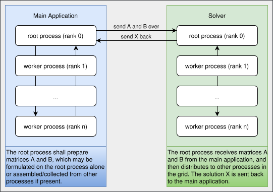

# Standalone Solver

`MPI` provides a mechanism to dynamically spawn worker processes through `MPI_Comm_spawn`.
By exploiting this feature, it is possible to separate the main application from the solver.
The architecture is illustrated below.



The `ezp` solvers are also available as standalone executables that follow this design.
Such a form is particularly beneficial when one or more of the following holds.

1. The main application is not suitable for a distributed-memory model, for example due to latency constraints.
2. The main application adopts a different parallelism pattern.
3. One wants a clear boundary between the main application and the solver.

The clear boundary can also be a shortcoming.
The root process must store the whole matrices in memory, which is subject to physical limitations.
Because the spawned processes are not persistent, solving the same system for different right-hand sides may incur unnecessary data communication.
If the matrices are read from file in a distributed manner, one may also need fine control over how the data is prepared, possibly by calling `BLACS`/`ScaLAPACK`/`MPI` functions directly.

## Backbone

The `pgesv` solver is used below to illustrate the critical steps of implementing this architecture.
`ezp` does not use the raw `MPI` functions directly; instead, the `mpl` library is used.
It is necessary to obtain the default communicator and the parent inter-communicator.

```cpp title="solver.full.hpp:24:25"
--8<--
./standalone/solver.full.hpp:24:25
--8<--
```

Because `mpl` handles `MPI` environment initialisation and finalisation, `ezp` must be told not to finalise `MPI`.
The function `ezp::blacs_env<>::do_not_manage_mpi()` must be called when `MPI` is managed externally.

```cpp title="solver.pgesv.cpp:54:55" hl_lines="1"
--8<--
./standalone/solver.pgesv.cpp:54:55
--8<--
```

The parameters of the linear system are broadcast from the main application first.

```cpp title="solver.pgesv.cpp:61:65" hl_lines="5"
--8<--
./standalone/solver.pgesv.cpp:61:65
--8<--
```

Knowing the problem sizes `N` and `NRHS`, the root process initialises the containers and receives the contents of the two matrices.

```cpp title="solver.full.hpp:28:40" hl_lines="3-5 9 10"
--8<--
./standalone/solver.full.hpp:28:40
--8<--
```

Solving the system follows the conventional approach: create a solver object, wrap the data, and call `solve`.
The solution is then sent back to the caller.

```cpp title="solver.full.hpp:42:47" hl_lines="1 5"
--8<--
./standalone/solver.full.hpp:42:47
--8<--
```

## The Caller

From the code snippets above, the caller must

1. broadcast `config`;
2. send `A` and `B`;
3. receive the error code and, if no error occurred, the solution `X`.

To this end, one declares the corresponding containers with `std::vector`.

```cpp title="runner.cpp:41:42" hl_lines="1 2"
--8<--
./standalone/runner.cpp:41:42
--8<--
```

The following creates a diagonal matrix for illustration.

```cpp title="runner.cpp:48:53" hl_lines="5 6"
--8<--
./standalone/runner.cpp:48:53
--8<--
```

Once all data is ready to be communicated, the communication itself is concise and straightforward.

```cpp title="runner.cpp:114:129" hl_lines="2 5 9 10 15 16"
--8<--
./standalone/runner.cpp:114:129
--8<--
```

## Python Caller

Because there is a clear boundary between the main application and the solver, any `MPI`-compatible caller can exchange the problem data.
For example, one can use [`mpi4py`](https://github.com/mpi4py/mpi4py) to call the solvers.

Note that the **column-major** memory layout must be preserved.
NumPy arrays are row-major by default, so they must be created with `order="F"`.

```py title="runner.py:41:76" hl_lines="15 21 27 31 33"
--8<--
./standalone/runner.py:41:76
--8<--
```

Calling the script with

```bash
./runner.py 2 6 2
```

produces the following correct solution.

```text
A:
 [[1. 0. 0. 0. 0. 0.]
 [0. 2. 0. 0. 0. 0.]
 [0. 0. 3. 0. 0. 0.]
 [0. 0. 0. 4. 0. 0.]
 [0. 0. 0. 0. 5. 0.]
 [0. 0. 0. 0. 0. 6.]]
B:
 [[1. 2.]
 [1. 2.]
 [1. 2.]
 [1. 2.]
 [1. 2.]
 [1. 2.]]
Solution:
 [[1.         2.        ]
 [0.5        1.        ]
 [0.33333333 0.66666667]
 [0.25       0.5       ]
 [0.2        0.4       ]
 [0.16666667 0.33333333]]
```

## Full Reference Implementation

The following is a full reference implementation of a standalone solver and its caller.

??? note "runner.cpp"
    ```cpp title="runner.cpp"
    --8<--
    ./standalone/runner.cpp:27:134
    --8<--
    ```

??? note "solver.pgesv.cpp"
    ```cpp title="solver.pgesv.cpp"
    --8<--
    ./standalone/solver.pgesv.cpp:51:76
    --8<--
    ```
